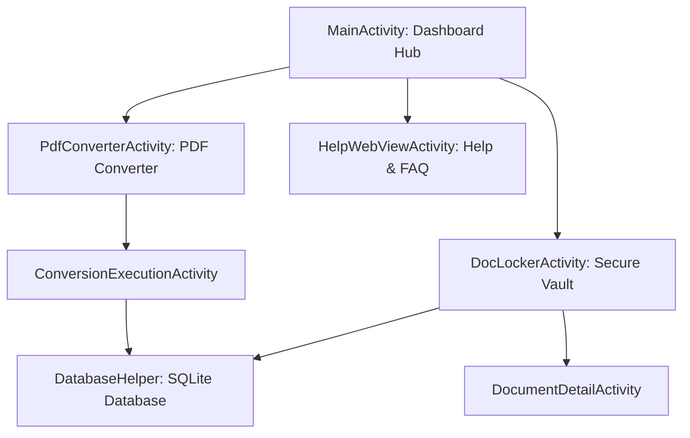

# Architecture Documentation

DocLocker follows a clean Model-View-Controller / Activity-Repository pattern using native Android Java and XML layouts.

- **Presentation Layer**: Activities (`MainActivity`, `DocLockerActivity`, `PdfConverterActivity`, etc.) and XML layout definitions.
- **Data Layer**: `DatabaseHelper` (SQLiteOpenHelper) managing local tables for documents and conversion history.
- **Platform Integration**: Intents (Explicit & Implicit SAF file picker, camera capture, share) and BroadcastReceiver.
